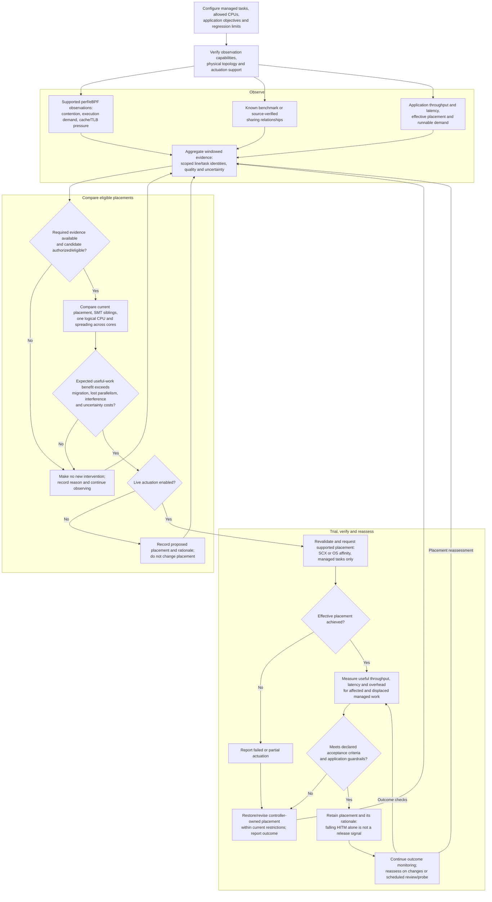

# Cache-Coherence Scheduler: Capability Flow

This diagram explains the proposed capability, not an implemented system. The goal is improved useful throughput and latency, not minimum HITM or maximum CPU utilization in isolation.

**Observation is evidence, not proof:** HITM samples can nominate contention relationships but do not alone identify the previous writer or establish false sharing. Known sharing groups are valid initial inputs. Required fields and counter paths must be verified on the selected CPU/kernel; missing data is not zero pressure.

**Placement is a measured intervention:** SMT siblings share a physical core, while one logical CPU serializes execution. Any relocation of unrelated work must be authorized and included in the benefit/guardrail evaluation. SCX CPU selection and queue insertion do not guarantee immediate co-execution.

**Feedback must account for success:** consolidation can remove the HITM signal that triggered it. Retention and release depend on application outcomes, the recorded rationale, and explicit reassessment rules, not signal disappearance alone. Restoration cannot reverse latency already incurred, and failed/partial changes must remain visible.

Linux/`sched_ext` is a candidate backend; initial experiments may use existing affinity controls. This diagram does not require the full multidimensional cost model or arbitrary-program detection before controlled placement experiments.

Related documents: [requirements](requirements.md), [system architecture](system-architecture.md), and [experimental methodology](experimental-methodology.md).
